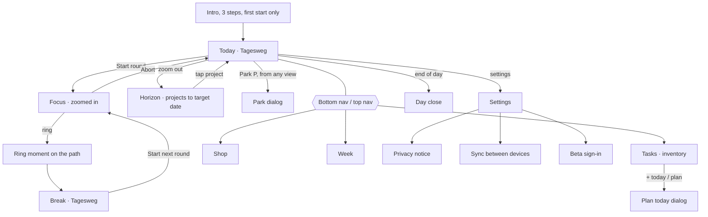

# UI concept: screen map and navigation

Status: POMO-42, 2026-11-13. Concept **A · Tagesweg** (Gianluca, POMO-43); requirements FR-601–609 in the vault
(`Projekte/Pomodoro/01_Anforderungen/2026-11-13_Anforderungen_Pomodoro_v0.4.md`, section 6).
Every later view ticket builds on this page, the wireframes in `wireframes/`, the tokens in
`src/ui/tokens.css` and the components in `src/ui/components/`.

## Principles

- **The day is the screen.** The main screen is the Tagesweg: one row per planned task, its rounds as
  stations, a path from the start of the day to the goal, rewards as accent rows between tasks (FR-602, FR-603).
- **Zoom follows the phase** (FR-604): in a round only the current task, the path piece and park/abort;
  at the ring and in the break the whole day again; the horizon is one level above the day (FR-607).
- **Time without digits** (FR-606): the remaining time is the rest of the path piece; digits on tap for 3 s,
  in the tab title (FR-108) and always when the setting «digits always» is on.
- **Calm** (FR-601): design system clean-white, light and dark follow the system and can be switched,
  no shadows, no confetti, accent on at most 1–2 elements per screen, coins as a plain number.
- **Name and words**: product name pomo.pomo comes from `APP_NAME` in `src/config.ts`; all texts from the
  i18n catalogs (NFR-11). No imagery of the method's trademark owner (POMO-33); the UI says «focus round» / «round», never the method's name (CLAUDE.md, FR-601).
- **Reach** (NFR-05): works from 360 px without horizontal scrolling; every control ≥ 44 × 44 px
  (`--touch-target`). Keys: Space start, P park, N next task (NFR-06).

## Screen map

| Screen                  | Purpose                           | Main content                                                                                                                         | Reached from                                      | Requirements                                           | Wireframe                               |
| ----------------------- | --------------------------------- | ------------------------------------------------------------------------------------------------------------------------------------ | ------------------------------------------------- | ------------------------------------------------------ | --------------------------------------- |
| Today · Tagesweg (main) | See the day, start the next round | coins, budget bar, Tagesweg rows with stations and reward rows, next-round card with Start and Park                                  | app start, nav «Today»                            | FR-102, FR-203, FR-602, FR-603, FR-605                 | `main-360.svg`, `main-desktop.svg`      |
| Focus                   | Work one round without noise      | task, round n of m, path piece, digits on tap, notes (FR-609), Park, Abort (strict) / Pause (flexible)                               | Start round, Space                                | FR-103, FR-106, FR-107, FR-205, FR-604, FR-606, FR-609 | `focus-360.svg`                         |
| Ring moment             | Show the gain on the path         | dot one station further, +coins, distance to next reward, «Redeem» when reached, Short break / Next round                            | end of round                                      | FR-301, FR-401, FR-407, FR-605                         | `ring-360.svg`                          |
| Break                   | Rest, see the day again           | Tagesweg, break bar, next round                                                                                                      | Short break                                       | FR-101, FR-604                                         | `pause-360.svg`                         |
| Horizon                 | Plan towards target dates         | projects as lines to their target date, today marked, tap = next round for that project                                              | zoom out (header)                                 | FR-607, FR-608                                         | `horizon-360.svg`                       |
| Tasks · inventory       | Keep all tasks                    | add / paste lines, project chips, rows with estimate, due/overdue, unplanned «U», «+ today»                                          | nav «Tasks»                                       | FR-201, FR-202, FR-204, FR-206–209, FR-608             | `inventory-360.svg`                     |
| Plan today (dialog)     | Fill today against the budget     | inventory rows to pick, order, budget bar «n over budget»                                                                            | inventory, main                                   | FR-203, FR-208                                         | — (uses dialog, list row, progress bar) |
| Park (dialog)           | Note an interruption in ≤ 2 steps | text field, internal / external, Enter saves; timer keeps running                                                                    | P key or park button in any view                  | FR-205                                                 | — (dialog)                              |
| Shop                    | Own rewards                       | balance, add reward, rows with price and «Redeem» / «n to go», history                                                               | nav «Shop», reward row                            | FR-402, FR-405, FR-406, FR-408                         | `shop-360.svg`                          |
| Day close               | Compare plan and actual           | per task estimate, actual, difference; interruptions internal / external                                                             | end of day prompt, main                           | FR-302, FR-304, FR-305                                 | — (card + list rows)                    |
| Week                    | Look back                         | rounds per day and project, plan fulfilment %                                                                                        | nav «Week»                                        | FR-303, FR-404                                         | — (card + bars)                         |
| Settings                | Adjust                            | profile durations, mode strict / flexible, gamification level, digits always, theme system / light / dark, language, export / import | header «Settings»                                 | FR-105, FR-107, FR-405, FR-606, FR-601, NFR-03, NFR-11 | — (card + list rows)                    |
| Privacy notice          | Where data lives                  | local data, sync, beta                                                                                                               | settings, footer link (≤ 2 steps from every view) | NFR-14                                                 | —                                       |
| Sync                    | Own repo between devices          | guided setup, sync now, disconnect                                                                                                   | settings                                          | NFR-10, NFR-13                                         | existing panel `src/sync/panel.ts`      |
| Beta sign-in            | Tester account                    | tester ID, key, consent, sign out                                                                                                    | settings                                          | FR-501–505                                             | existing panel `src/beta/panel.ts`      |
| Intro                   | Method and app in ≤ 3 steps       | three cards, Skip                                                                                                                    | first start                                       | NFR-15                                                 | —                                       |

## Navigation

- **Mobile (< 1024 px):** bottom nav with four items: Today, Tasks, Shop, Week. Header: product name, coin
  balance, icon buttons Horizon and Settings. Hidden in the focus view (FR-604).
- **Desktop (≥ 1024 px):** same four items as top nav; Today shows the Tagesweg left and the next-round card
  plus «Unplanned & urgent» and parked thoughts right (`main-desktop.svg`).
- **Gamification level** (FR-405): «off» hides coins, reward rows, the Shop nav item and the streak;
  «subtle» shows coins and shop; «full» adds streak and random bonus.
- **Dialogs** (park, plan today, abort confirmation, edit task) use `openDialog`: focus moves in, Tab
  stays inside, Escape closes, focus returns to the opener.
- **Short confirmations** («Thought parked», «Task deleted · Undo») use the toaster (polite live region).

## Wireframes

Low-fi, 360 px wide unless named desktop; orange notes are annotations, not UI. Texts are English
placeholders; real texts come from the catalogs. Regenerate with
`python3 docs/ui/wireframes/generate.py docs/ui/wireframes`.

| File                           | Shows                                                                                                                                                                                                                      |
| ------------------------------ | -------------------------------------------------------------------------------------------------------------------------------------------------------------------------------------------------------------------------- |
| `wireframes/main-360.svg`      | Tagesweg overview: coins, today budget bar (2 of 6 planned, budget 8), 4 tasks (2/2/1/1 rounds) with 6 stations, 2 done, location at station 3, two reward rows, next-round card with Start round and park key, bottom nav |
| `wireframes/main-desktop.svg`  | Same day on 1280 px: path left, next-round card and extras right                                                                                                                                                           |
| `wireframes/focus-360.svg`     | Round running: task, path piece, digits on tap, notes, Park and Abort                                                                                                                                                      |
| `wireframes/ring-360.svg`      | Ring moment: dot one station further, +10 coins, «10 to go until …»                                                                                                                                                        |
| `wireframes/pause-360.svg`     | Break: full Tagesweg, break bar, start next round                                                                                                                                                                          |
| `wireframes/horizon-360.svg`   | Horizon: three projects to their target dates, today line                                                                                                                                                                  |
| `wireframes/inventory-360.svg` | Inventory: add/paste, project chips, due and overdue, unplanned, + today                                                                                                                                                   |
| `wireframes/shop-360.svg`      | Shop: balance, rewards with Redeem / n to go, history                                                                                                                                                                      |

Legend in wireframes: `Hz` = Horizon icon button, `Set` = Settings, `P` = park key.

## Design tokens and components

- `src/ui/tokens.css`: colours (light, dark via system and `data-theme`), type scale, spacing (4 px grid),
  radius, sizes (touch target 44 px, path width, station size), motion (calm; zero with reduced motion).
  `tokens.test.ts` proves WCAG AA: every text token ≥ 4.5 on every surface, path/station/focus ring ≥ 3, in
  both modes.
- `src/ui/theme.ts`: `createTheme()` applies the stored choice system / light / dark without reload.
- `src/ui/components/`: `button`, `iconButton`, `card`, `listRow` (tone `reward` for reward rows, `done`),
  `progressBar` (budget bar with over-budget state), `openDialog`, `createToaster`. Each takes already
  translated text and returns DOM nodes; styles in `components.css`.

Mapping wireframe → components: header coins = plain text; Horizon/Settings/Park = `iconButton`; budget bar =
`progressBar`; reward rows and task rows in lists = `listRow`; next-round card and ring moment = `card`
(`highlight` for the ring); Start round = `button` primary. The Tagesweg path itself (SVG lanes, stations,
location dot) is its own view module in the main-screen ticket.
